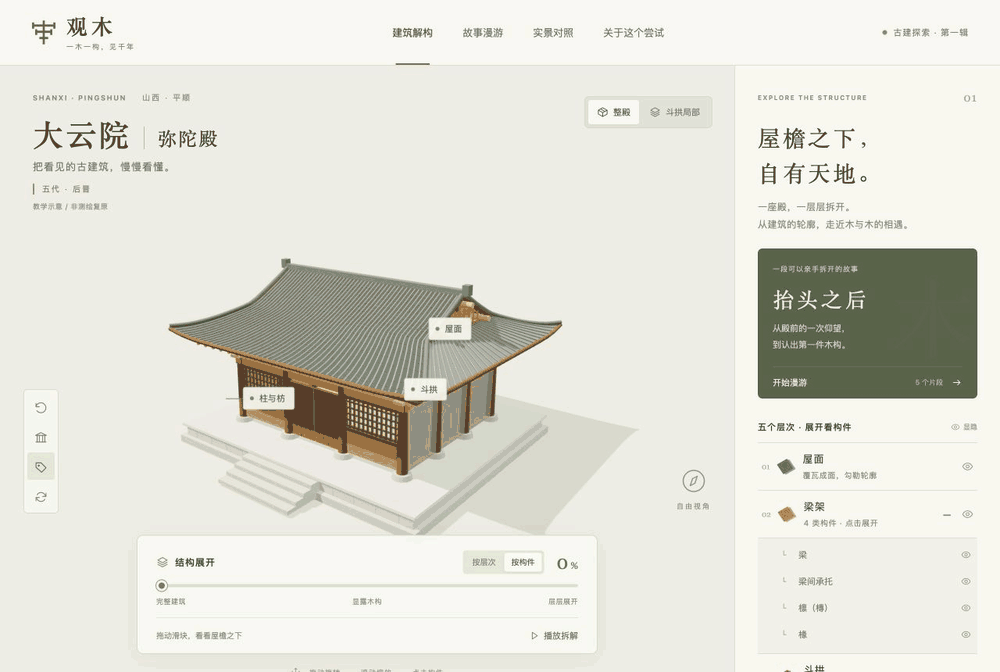

# 观木 · 中国古建筑交互探索

**从一次仰望，到一次理解。**

观木是一个面向古建旅行者和建筑入门者的交互网站。通过三维拆解、构件特写、故事漫游与实景对照，把“这座建筑真好看”逐渐变成“我知道眼前这件木头叫什么、有什么作用、与谁相接”。



实际页面录制：整殿展开 → 斗拱局部 → 构件特写与作用说明。约 14 秒循环播放；展示的是当前教学示意模型。

项目始于一次山西古建旅行：面对优美的建筑，专业术语常常让人难以继续理解。我们希望让用户先看见形状、亲手观察，再认识名称和关系。

目前是可本地运行的前端原型，首个观察对象为 **山西省平顺县实会村大云院弥陀殿**。首页已经建立古建目录，但当前只有这一座建筑开放探索。

> 当前模型用于教学示意，尚未完成测绘复原。构件位置、比例、数量和连接细节的简化程度，见下文“内容与模型边界”。

[快速开始](#快速开始) · [当前体验](#当前体验) · [开发说明](#开发说明) · [资料与授权](#资料与授权) · [发展路线](./ROADMAP.md)

## 希望用户带走什么

完成一次探索后，用户能够在实景中找到刚刚观察过的构件，说出它的名称、基本作用及与周围木件的关系。

推荐的体验顺序：

1. 从首页选择大云院，先看建筑的整体轮廓。
2. 展开屋面和木构，观察梁、檩、椽、柱与斗拱的位置。
3. 点选一件构件，在独立三维特写中旋转、放大，阅读作用与连接说明。
4. 进入《抬头之后》，通过五个片段认识斗、栱与普拍枋。
5. 回到真实照片，试着认出它们。

也可以跳过故事，直接自由拆解与观察。

## 当前体验

| 模块 | 已实现的能力 |
| --- | --- |
| 首页与古建目录 | 实景封面、建筑入口、探索方式；大云院可进入，后续建筑显示为待开放 |
| 整殿探索 | 拖动旋转、缩放、正面观察、视角复位、自动旋转、构件名称标注 |
| 分层与构件拆解 | 按层次或按构件展开；五个大层次下可进一步选择和显隐八类构件 |
| 斗拱局部 | 14 件独立木构示意，支持编号点选、逐件抽出、放回；抽出时其他木件淡化 |
| 构件特写 | 点选后独立居中放大，可旋转、缩放和复位，并显示名称、作用、连接关系。底部大斗另有一条完整样例：关键部位标注、相邻构件、回到原位置 |
| 故事漫游 | 《抬头之后》五幕，联动模型与照片，包含操作反馈和实景辨认；可跳转、退出、重播 |
| 实景与资料 | 两张本地照片、资料外链、摄影署名、授权信息及模型边界说明。从底部大斗样例进入柱头铺作照片时，标有一处教学观察点 |
| 基础适配 | 桌面与窄屏布局、部分键盘操作；已编写 WebGL 初始化失败时的实景与文字回退 |

五个大层次为屋面、梁架、斗拱、柱与枋、台基。八类可进一步观察的构件为梁、梁间承托、檩、椽、柱、阑额、普拍枋、柱础。

斗拱局部的 **14 件是本教学模型的件数**：普拍枋 1 件、斗 8 件、栱 3 件、出挑构件 2 件，不是大云院实物构件清单。由多个几何块组成的一个斗仍按一件计数。

## 快速开始

### 环境

- Node.js：Vite 当前依赖要求 `^20.19.0 || >=22.12.0`。
- pnpm：使用 [package.json](./package.json) 中 `packageManager` 指定的版本，当前为 `11.25.0`。
- 支持 WebGL 的现代浏览器用于三维探索。

在项目根目录运行：

```sh
pnpm install --frozen-lockfile
pnpm dev
```

打开终端输出的网址，默认是 `http://127.0.0.1:5173/`；端口被占用时以实际输出为准。

| 命令 | 用途 |
| --- | --- |
| `pnpm dev` | 启动本地开发服务 |
| `pnpm build` | 生成生产静态文件到 `dist/` |
| `pnpm preview` | 在本地预览已构建的 `dist/` |

当前没有后端、数据库、登录系统或外部 API 密钥配置，不需要 `.env`。开发和预览服务均绑定 `127.0.0.1`，默认只供本机访问。

### 页面入口

| 地址 | 页面 |
| --- | --- |
| `/` | 观木首页 |
| `/#/dayun` | 大云院弥陀殿探索页 |

故事和构件特写在建筑页面中打开，目前没有独立分享地址。点击左上角“观木”返回首页；支持浏览器前进、后退与建筑页面刷新。故事进度仅保存在本次页面会话中，刷新或重新开始后重置。

项目尚未部署。`pnpm build` 仅生成静态文件，不会自动发布网站。

## 内容与模型边界

### 建筑与构件

整殿轮廓与结构类型参考公开资料，尺寸、柱网、梁架排布、斗拱、台基、瓦面及装饰均经过简化。斗拱局部采用通用组合关系模型，不能作为弥陀殿五铺作的精确形制或实物复原依据。

梁间承托目前以块体表示，未还原驼峰形制；斜撑等细节尚未建模。隐蔽榫卯、壁画、彩画、脊饰及历次修缮痕迹尚未复原。构件特写展示现有模型中的代表形态，独立放大后的大小不能用于比较构件的真实尺寸。

展开与抽出动画表达空间层次，不代表真实施工或拆卸顺序，也不提供受力计算。精确建模前，需要取得并核验测绘图、构件详图及尺寸，并进行古建专业复核。

### 故事与历史

《抬头之后》的旅行情境和旁白由项目创作，不是历史人物口述或真实事件记录。构件解释沿用资料与教学模型；未经核验的营造者、传说和修缮情节没有被补写成历史事实。

后续内容应持续区分：有来源支持的事实、教学简化、待核验判断与创作情境。跨朝代比较和真实榫卯演示目前尚未实现，见 [ROADMAP](./ROADMAP.md)。

## 开发说明

### 技术与组织

采用原生 JavaScript ES Modules、CSS、Three.js 与 Vite。模型由程序化几何生成，未接入扫描模型或外部建模文件。具体依赖版本以 [pnpm-lock.yaml](./pnpm-lock.yaml) 为准。

```text
sunmao-3d/
├── index.html          # 页面入口
├── src/
│   ├── main.js         # 页面装配、交互状态与 hash 导航
│   ├── home.js         # 首页模板与当前建筑目录
│   ├── content.js      # 构件释义、照片、来源与故事章节
│   ├── model.js        # 整殿及斗拱几何、相机、点选、显隐与拆解
│   ├── inspector.js    # 独立三维构件特写
│   ├── story.js        # 故事进度、章节切换与操作反馈
│   ├── style.css       # 通用样式与探索页布局
│   ├── home.css        # 首页和构件特写样式
│   └── story.css       # 故事布局与窄屏适配
├── public/
│   ├── favicon.svg
│   └── images/         # 已署名的实景照片
├── docs/media/         # README 使用的演示动图
├── README.md
└── ROADMAP.md
```

`main.js` 协调主模型、故事和特写的状态。`StoryTour` 通过回调触发场景切换并记录操作反馈；`ComponentInspector` 从主模型取得代表构件，只读复用几何、单独克隆材质，关闭时停止特写渲染。

### 修改与扩展

| 想修改的内容 | 主要位置 |
| --- | --- |
| 构件名称、释义、连接关系与来源 | `src/content.js` |
| 特写中的简短作用说明 | `src/inspector.js` 中的 `roles` |
| 模型形状、位置与拆解方式 | `src/model.js` |
| 故事文案与章节 | `src/content.js`；行为与反馈逻辑在 `src/story.js` |
| 首页建筑卡片 | `src/home.js` |
| 页面切换与各模块联动 | `src/main.js` |
| 底部大斗教学样例 | `src/content.js` 的 `teachingSample`；特写标注在 `src/inspector.js` |

当前内容仍围绕大云院组织。**新增一张首页卡片不会自动接入另一座建筑**：路由、模型、构件、照片和故事都需要对应实现。第二座古建接入前，计划先抽离每座建筑的数据与模型入口。修改构件释义时，也需同步检查特写中的作用摘要，避免两处表述不一致。

## 资料与授权

以下为原型已采用的资料线索；本次文档整理没有重新进行外部文献核验。

| 资料 | 当前用途与范围 |
| --- | --- |
| [山西大学考古文博学院 · 大云院](https://archaeology.sxu.edu.cn/rcpy/yxsx/903e5ed4860542ddb1992a6f5c1a6368.htm) | 建筑背景和普拍枋介绍；页面内部对始建年份、壁画面积的表述存在差异，原型未据此给出精确数值 |
| [张洪峰《大云院现状初探》](https://m.fx361.com/news/2023/0807/22316981.html) | 《收藏与投资》2023 年第 7 期；仅参考公开可读部分，未读取付费或登录后的全文 |
| [弥陀殿外观原图](https://commons.wikimedia.org/wiki/File:大云院大雄宝殿.jpg) | 本地照片 `public/images/dayun-hall.jpg` |
| [柱头斗拱原图](https://commons.wikimedia.org/wiki/File:大云院大佛殿柱头铺作.jpg) | 本地照片 `public/images/dayun-dougong.jpg` |
| [殿内梁架近照](https://commons.wikimedia.org/wiki/File:大佛殿内部梁架.jpg)、[梁架斜撑近照](https://commons.wikimedia.org/wiki/File:大佛殿大叉手.jpg) | 仅提供原页面外链，未下载或内嵌；原图标题“大叉手”不单独作为精确定名依据 |
| [Vincent H P Liu · 大云院图像集](https://www.flickr.com/photos/24164990@N07/albums/72157622923750090) | 包含剖面与斗拱图像线索；页面标注保留所有权利，仅提供外链，未复制图片 |

本地两张实景照片由 **Patrick20242023** 摄于 **2024-02-15**，来自 Wikimedia Commons，遵循 [CC BY 4.0](https://creativecommons.org/licenses/by/4.0/)。保留原始图片文件；首页通过 CSS 裁切和降低饱和度展示，图注已说明。外观图片文件名沿用上传者的“大雄宝殿”，界面统一称为“弥陀殿”。

第三方照片的许可只适用于对应素材。目前仓库未设置项目代码的开源许可证；公开分发前需要另行明确代码与自有内容的许可。

## 验证状态与已知限制

截至 **2026-10-16**，上一轮功能开发已完成以下检查；本节记录历史验证结果，文档修改本身不代表重新执行这些测试。

- 生产构建通过。主脚本 gzip 约 161 kB，仍有单个资源超过 500 kB 的构建提示。
- 在应用内浏览器以 1440 × 1000 和 390 × 844 视口检查，无横向溢出。
- 走查了首页进出、浏览器后退、建筑地址刷新、构件点选与特写、显隐与拆解、单件抽出及放回、实景切换、来源弹窗。
- 完成五幕故事、操作反馈、问答正确与错误反馈、重播和退出到自由探索的检查。
- 检查时未捕获到 JavaScript 错误。截图保存在本地 `.qa/`，该目录不纳入 Git。

当前未配置自动化测试或 lint 命令。真实手机性能、其他浏览器、WebGL 故障回退、完整无障碍体验及专业建筑准确性尚未验证。窄屏模拟结果不等于真实设备测试结果。

界面改动后，应走查“首页 → 建筑 → 点选特写 → 拆解 → 故事 → 实景 → 返回首页”这条路径，并运行 `pnpm build`；修改模型或说明时，还需核对对应资料和模型边界。

## 下一步

优先让当前构件更容易读懂，补齐可追溯资料与专业复核，再以第二座资料充分的古建验证多建筑结构。跨朝代比较、更多历史故事和发布准备见 [ROADMAP](./ROADMAP.md)。
